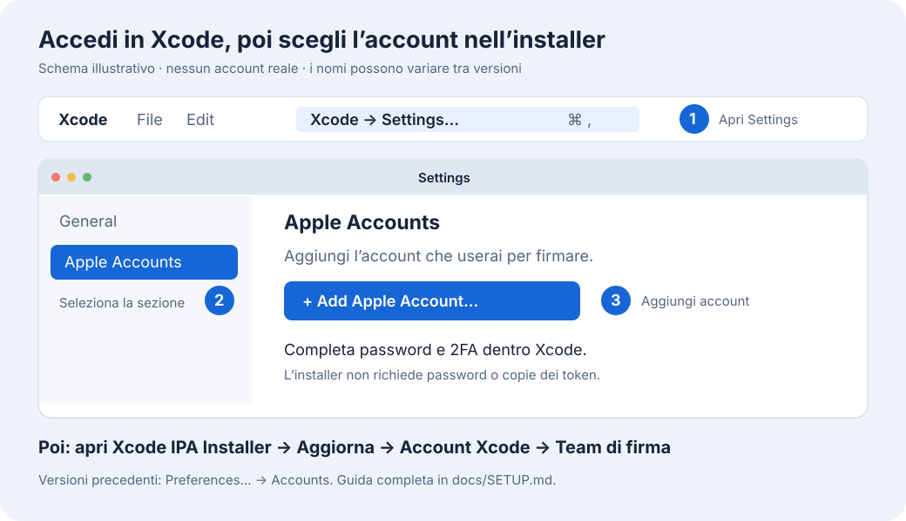

# Xcode IPA Installer

App macOS nativa per firmare IPA e installarle su iPhone con gli **account già autenticati in Xcode** oppure **certificati P12 e profili importati**. Seleziona account, team e dispositivo, poi firma sul Mac senza server anisette esterni.

[English](README.md) · **[Scarica l’app](https://github.com/dre4moff/Xcode-IPA-Installer/releases/latest)** · **[Guida alla configurazione](docs/SETUP.it.md)** · [Licenza MIT](LICENSE)



## Configurazione rapida

1. Installa **Xcode completo**, aprilo e completa la configurazione iniziale degli strumenti iOS.
2. In Xcode apri **Xcode → Settings… → Apple Accounts** e aggiungi il tuo Apple Account con **+ / Add Apple Account…**. Completa password e 2FA direttamente in Xcode. Nelle versioni precedenti la sezione si chiama **Accounts**.
3. Collega l’iPhone via USB, autorizza il Mac e abilita **Impostazioni → Privacy e sicurezza → Modalità sviluppatore** sull’iPhone.
4. Apri Xcode IPA Installer, aggiorna l’elenco e seleziona **account, team e iPhone**. Se il team non compare, usa **Configura team…** seguendo la [guida](docs/SETUP.it.md#3-configurare-il-team).
5. Scegli l’IPA. Attiva **Increased Memory Limit** se necessario, poi usa **Solo firma** o **Firma e installa**.

Il download contiene un’app universale **Apple Silicon e Intel**, per macOS 12 o successivo. Con Xcode 15+ si usa `devicectl`. Con Xcode precedente si usa `xcdevice` e, per installare via USB su iOS 16 o precedenti, `ios-deploy` installato separatamente con `brew install ios-deploy`. L’esportazione con Solo firma non richiede questo strumento. Per iOS 17+ serve una combinazione compatibile di Xcode e macOS. La build è firmata ad hoc e non è notarizzata. Se macOS la blocca, verifica l’origine del download e segui la [procedura Apple per aprire un’app attendibile](https://support.apple.com/en-us/102445), con l’eventuale pulsante **Apri comunque** in Impostazioni di Sistema → Privacy e sicurezza.

## Certificati e profili importati

In **Firma → Certificato importato → Importa certificato…**, scegli la cartella con il `.p12` / `.pfx` e i `.mobileprovision`, oppure seleziona i file singolarmente. Inserisci la password del P12 nell’app; lasciala vuota se assente. I file di testo non vengono letti. La chiave privata viene importata nel Portachiavi predefinito del Mac dopo la verifica di corrispondenza con i profili. La password passa attraverso una pipe privata e non viene salvata. Gestisci personalmente le eventuali richieste del Portachiavi.

Scegli certificato e **Profilo dell’app principale**. Per ogni estensione viene preferito un profilo specifico compatibile, se disponibile; altrimenti può essere riutilizzato quello selezionato, con il suo App ID di firma autorizzato. Dal menu di gestione puoi **Aggiungere profili…** per le estensioni dello stesso certificato. **Rimuovi dalla lista** elimina solo metadati e copie dei profili dell’app; l’identità rimane in Accesso Portachiavi, perché può essere usata da altri strumenti. I file originali restano invariati.

In questa modalità **i Bundle ID originali dell’app e delle estensioni vengono sempre mantenuti**, senza suffissi o sostituzioni. L’entitlement `application-identifier` della firma è separato: un profilo esplicito fornisce il proprio App ID di firma senza rinominare i bundle. App diverse possono quindi mantenere identificativi di installazione distinti usando lo stesso App ID di firma del profilo. Con una wildcard viene calcolato un App ID concreto autorizzato, senza cambiare i Bundle ID.

La gestione segue i metadati usati da [Zsign/Feather](https://github.com/claration/zsign/blob/package/src/openssl.cpp) ed è stata confrontata con un’IPA prodotta da ESign. Il provisioning automatico Xcode mantiene invece la corrispondenza stretta tra Bundle ID e App ID. Certificato, chiave, team, dispositivo, scadenza e tutti i permessi dichiarati nella firma restano verificati. Servizi legati all’app, portachiavi condiviso, widget, Live Activities e notifiche possono richiedere ulteriori condizioni oltre a una firma valida; il collaudo sul dispositivo resta separato.

Le capability originali autorizzate vengono mantenute; quelle opzionali non supportate, come CarPlay, vengono escluse e segnalate nel log e nel rapporto. Le funzioni che dipendono dai permessi esclusi potrebbero non funzionare. Con **Opzioni → Richiedi tutte le capability originali** puoi imporre l’interruzione invece dell’esclusione. I gruppi portachiavi autorizzati vengono mantenuti, usando un gruppo derivato dall’App ID di firma quando necessario e autorizzato.

Increased Memory Limit resta obbligatorio sul principale quando attivo; EVA originale viene mantenuta se autorizzata. `get-task-allow` segue il profilo di ciascun processo, anche quando consente il debug. Può quindi essere mantenuta la compatibilità con strumenti JIT adatti, senza forzare un profilo di distribuzione a consentirlo. JIT richiede anche dispositivo, sistema, app e metodo compatibili. [Documentazione Apple](https://developer.apple.com/documentation/technotes/tn3125-inside-code-signing-provisioning-profiles)

Questa modalità non usa account Apple o anisette remoto e non richiede nuovi profili ad Apple. Serve ancora Xcode completo per Python e gli strumenti dei dispositivi. Scadenze, dispositivi, revoche e permessi dipendono dai file importati. Il rapporto riporta modalità, fingerprint del certificato, UUID dei profili e stato debug/EVA per ogni processo.

## Interfaccia e lingue

Il contenuto scorre mentre i comandi di firma restano in basso. Sulle finestre strette i campi si dispongono in colonna. Liquid Glass viene usato da macOS 26; macOS 12–25 usa materiali nativi e pulsanti standard. La lingua segue macOS: inglese come lingua principale e fallback, italiano disponibile, senza selettore nell’app. Anche i messaggi operativi sono localizzati.

## Memoria e firma dei componenti

- **Increased Memory Limit** viene richiesto e verificato **solo sull’eseguibile principale**, con lo stesso team che firma l’app. Se la checkbox è attiva e il profilo non lo autorizza, la procedura si interrompe: non viene prodotto un risultato dichiarato riuscito senza questa capability.
- **Extended Virtual Addressing (EVA)** è separata. Se presente nell’IPA originale, viene mantenuta quando il team la supporta. È esclusa per i Personal Team; se Xcode ne segnala esplicitamente l’indisponibilità su un altro team, il provisioning viene ritentato una volta senza EVA. Increased Memory Limit resta indipendente. La regola vale per tutte le IPA.
- App incorporate, estensioni, JIT helper, framework e librerie vengono comunque **firmati e verificati tutti**, dall’interno verso l’esterno. Le capability memoria non vengono applicate ai processi ausiliari. Framework e librerie condividono i limiti del processo che li carica.
- Le capability originali vengono richieste al team Xcode selezionato. Se Xcode rifiuta esplicitamente capability opzionali, il provisioning viene ripetuto rimuovendo soltanto quei permessi. Il profilo generato determina le capability firmabili; le esclusioni vengono elencate per processo nel log e nel rapporto. Errori di autenticazione, identità, limiti del dispositivo o assenza di Increased Memory Limit richiesto interrompono la procedura. I metadati WidgetKit e Live Activities e le relazioni tra identificativi vengono mantenuti. I gruppi del portachiavi vengono riscritti coerentemente. Gli App Groups mantengono i nomi originali se disponibili; vengono rimossi solo gli identificativi esplicitamente rifiutati come non disponibili per il nuovo team, indicandoli anche nel rapporto.

La capability memoria non aggiunge RAM fisica e il limite effettivo dipende da iOS e dal dispositivo. Live Activities, Dynamic Island, iCloud, App Groups e servizi push dipendono anche dall’app e dalle autorizzazioni del nuovo team. Una firma valida non trasferisce i servizi del team originale. [Memoria: documentazione Apple](https://developer.apple.com/documentation/bundleresources/entitlements/com.apple.developer.kernel.increased-memory-limit) · [EVA: documentazione Apple](https://developer.apple.com/documentation/bundleresources/entitlements/com.apple.developer.kernel.extended-virtual-addressing) · [ActivityKit](https://developer.apple.com/documentation/activitykit/displaying-live-data-with-live-activities)

## Account e dati locali

L’app legge i metadati degli account dalle preferenze di Xcode e usa `DEVELOPMENT_TEAM` per scegliere il team. Se lo stesso team risulta associato a più account autenticati, interrompe la firma: Xcode non offre qui una selezione univoca del singolo membro tramite il solo Team ID. I Personal Team distinti possono essere selezionati separatamente.

Non importa password, OTP o token da Xcode e non esporta chiavi private. Xcode gestisce la propria sessione; `codesign` usa il Portachiavi del Mac. Quando necessario Xcode contatta i servizi Apple per App ID, dispositivi, certificati e profili. L’assenza di anisette remoto non elimina la necessità di una connessione ad Apple.

L’IPA sorgente resta invariata. L’IPA firmata e un rapporto `.verification.json` vengono salvati in **Download**, anche con **Firma e installa**. Il rapporto elenca componenti, team, capability memoria e scadenze. I file di lavoro e DerivedData temporanei vengono rimossi al termine o all’annullamento. I log restano disponibili tramite **Apri log**.

I dati locali si trovano in `~/Library/Application Support/Xcode IPA Installer`, oppure `~/.local/share/XcodeIPAInstaller` se la prima posizione non è scrivibile. `accounts.json` conserva le associazioni dei team. `Signing Assets` contiene metadati dei certificati e copie dei profili importati; le chiavi private restano nel Portachiavi e la password del P12 non viene conservata. I log e i rapporti possono contenere nomi account, Team ID, identificativi dispositivi e percorsi: controllali prima di condividerli.

**In modalità Xcode, dalla versione 1.0.5 il Bundle ID principale è quello originale più il suffisso del team di firma selezionato**: `com.example.App.ABCDEFGHIJ`. Se termina già con il Team ID corretto, non viene duplicato. Non vengono aggiunti prefissi o identificativi del Mac. Gli identificativi delle estensioni e delle app incorporate seguono il nuovo principale: ad esempio `com.example.App.ABCDEFGHIJ.Widget`. L’interfaccia mostra l’ID di firma in sola lettura e lo aggiorna quando cambi team.

Il suffisso deriva dal team associato all’account Xcode selezionato. Il backend lo calcola indipendentemente dall’interfaccia, rifiuta un ID non corrispondente e verifica team, profilo e firma di ogni processo. Il rapporto registra `bundleIDPolicy: selectedTeamSuffix`, oltre a ID originali e finali. Le relazioni tra i componenti vengono aggiornate coerentemente; gli altri metadati vengono conservati.

Un aggiornamento richiede l’intero Bundle ID della copia già installata e una firma compatibile. Se quella copia usa già lo stesso schema `<ID originale>.<Team ID>`, viene preparata con lo stesso identificativo principale. ID creati con altri schemi, inclusi i vecchi prefissi automatici dell’installer, restano app distinte: i dati non vengono migrati tra identificativi diversi. Se Apple non autorizza l’ID con il suffisso del team, la procedura si interrompe. L’eventuale `installation-id.txt` delle vecchie versioni viene conservato, ma non viene più utilizzato.

## Compilazione e verifiche

Non sono richieste dipendenze di terze parti: SwiftUI/AppKit, Python 3.8+ fornito dagli strumenti Xcode e utility di macOS/Xcode.

```sh
git clone https://github.com/dre4moff/Xcode-IPA-Installer.git
cd Xcode-IPA-Installer
zsh test.sh
zsh build.sh "$HOME/Downloads/Xcode-IPA-Installer-build"
```

`build.sh` crea una nuova `Xcode IPA Installer.app` universale Apple Silicon e Intel firmata ad hoc; rifiuta di sovrascrivere un’app già presente. `test.sh` compila fixture iOS con firma disabilitata e verifica il backend con firme ad hoc reali, controllando suffisso del team, relazioni tra componenti, metadati e parità della policy Swift/Python. Il provisioning Apple e l’installazione sono sostituiti da fixture: **i test non usano account reali e non installano nulla sull’iPhone**. Entrambi gli script puliscono i propri file temporanei.

Sono coperti firma dei componenti annidati, policy principale-solo, EVA disponibile/non disponibile, conservazione delle altre capability e interruzione su profili o firme non conformi. Il collaudo con account Apple e dispositivo reale rimane separato dai test offline.

Non sono supportate IPA App Store con eseguibili cifrati, pacchetti Watch ed eseguibili autonomi privi di un bundle app/estensione con profilo dedicato. I limiti e le scadenze del provisioning Apple continuano ad applicarsi.

L’opzione memoria usa la stessa capability Apple impiegata da [GetMoreRam](https://github.com/hugeBlack/GetMoreRam). Questo progetto usa gli strumenti di firma di Xcode direttamente e non incorpora il suo codice.
