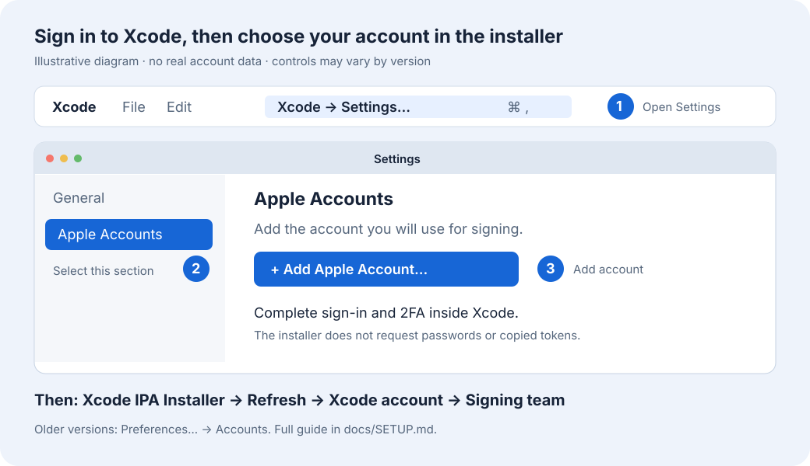

# Xcode IPA Installer

App macOS nativa per firmare IPA e installarle su iPhone con gli **account già autenticati in Xcode**. Seleziona account, team e dispositivo, poi firma sul Mac senza server anisette esterni.

**[Scarica l’app](https://github.com/dre4moff/Xcode-IPA-Installer/releases/latest)** · **[Guida alla configurazione](docs/SETUP.md)** · [Licenza MIT](LICENSE)



## Configurazione rapida

1. Installa **Xcode completo**, aprilo e completa la configurazione iniziale degli strumenti iOS.
2. In Xcode apri **Xcode → Settings… → Apple Accounts** e aggiungi il tuo Apple Account con **+ / Add Apple Account…**. Completa password e 2FA direttamente in Xcode. Nelle versioni precedenti la sezione si chiama **Accounts**.
3. Collega l’iPhone via USB, autorizza il Mac e abilita **Impostazioni → Privacy e sicurezza → Modalità sviluppatore** sull’iPhone.
4. Apri Xcode IPA Installer, aggiorna l’elenco e seleziona **account, team e iPhone**. Se il team non compare, usa **Configura team…** seguendo la [guida](docs/SETUP.md#3-configurare-il-team).
5. Scegli l’IPA. Attiva **Increased Memory Limit** se necessario, poi usa **Solo firma** o **Firma e installa**.

Il download contiene un’app **Apple Silicon arm64**, per macOS 13 o successivo. La gestione dei dispositivi usa `devicectl`: serve **Xcode 15 o successivo**, compatibile con il sistema del Mac e dell’iPhone. La build è firmata ad hoc e non è notarizzata. Se macOS la blocca, verifica l’origine del download e segui la [procedura Apple per aprire un’app attendibile](https://support.apple.com/en-us/102445), con l’eventuale pulsante **Apri comunque** in Impostazioni di Sistema → Privacy e sicurezza.

## Memoria e firma dei componenti

- **Increased Memory Limit** viene richiesto e verificato **solo sull’eseguibile principale**, con lo stesso team che firma l’app. Se la checkbox è attiva e il profilo non lo autorizza, la procedura si interrompe: non viene prodotto un risultato dichiarato riuscito senza questa capability.
- **Extended Virtual Addressing (EVA)** è separata. Se presente nell’IPA originale, viene mantenuta quando il team la supporta. È esclusa per i Personal Team; se Xcode ne segnala esplicitamente l’indisponibilità su un altro team, il provisioning viene ritentato una volta senza EVA. Increased Memory Limit resta indipendente. La regola vale per tutte le IPA.
- App incorporate, estensioni, JIT helper, framework e librerie vengono comunque **firmati e verificati tutti**, dall’interno verso l’esterno. Le capability memoria non vengono applicate ai processi ausiliari. Framework e librerie condividono i limiti del processo che li carica.
- Per impostazione predefinita le altre capability originali vengono conservate e richieste al team. I metadati WidgetKit e Live Activities e le relazioni tra identificativi vengono mantenuti. I gruppi del portachiavi vengono riscritti coerentemente; gli App Groups conservano i nomi originali.

La capability memoria non aggiunge RAM fisica e il limite effettivo dipende da iOS e dal dispositivo. Live Activities, Dynamic Island, iCloud, App Groups e servizi push dipendono anche dall’app e dalle autorizzazioni del nuovo team. Una firma valida non trasferisce i servizi del team originale. [Memoria: documentazione Apple](https://developer.apple.com/documentation/bundleresources/entitlements/com.apple.developer.kernel.increased-memory-limit) · [EVA: documentazione Apple](https://developer.apple.com/documentation/bundleresources/entitlements/com.apple.developer.kernel.extended-virtual-addressing) · [ActivityKit](https://developer.apple.com/documentation/activitykit/displaying-live-data-with-live-activities)

## Account e dati locali

L’app legge i metadati degli account dalle preferenze di Xcode e usa `DEVELOPMENT_TEAM` per scegliere il team. Se lo stesso team risulta associato a più account autenticati, interrompe la firma: Xcode non offre qui una selezione univoca del singolo membro tramite il solo Team ID. I Personal Team distinti possono essere selezionati separatamente.

Non importa password, OTP o token da Xcode e non esporta chiavi private. Xcode gestisce la propria sessione; `codesign` usa il Portachiavi del Mac. Quando necessario Xcode contatta i servizi Apple per App ID, dispositivi, certificati e profili. L’assenza di anisette remoto non elimina la necessità di una connessione ad Apple.

L’IPA sorgente resta invariata. L’IPA firmata e un rapporto `.verification.json` vengono salvati in **Download**, anche con **Firma e installa**. Il rapporto elenca componenti, team, capability memoria e scadenze. I file di lavoro e DerivedData temporanei vengono rimossi al termine o all’annullamento. I log restano disponibili tramite **Apri log**.

I dati locali si trovano in `~/Library/Application Support/Xcode IPA Installer`, oppure `~/.local/share/XcodeIPAInstaller` se la prima posizione non è scrivibile. `accounts.json` conserva le associazioni dei team. I log e i rapporti possono contenere nomi account, Team ID, identificativi dispositivi e percorsi: controllali prima di condividerli.

**Dalla versione 1.0.4 gli identificativi originali dell’IPA restano invariati**, comprese estensioni e app incorporate. Non vengono aggiunti prefissi, suffissi del team o identificativi del Mac; l’interfaccia li mostra senza consentire la rinomina. Anche i file `Info.plist` vengono conservati. Il rapporto registra `bundleIDPolicy: preserveOriginal`.

Un aggiornamento richiede lo stesso Bundle ID della copia già installata e una firma compatibile. Le versioni fino alla 1.0.3 generavano un ID distinto: un’IPA con ID originale differente da quello installato continuerà a essere un’app diversa. L’installer non rinomina l’IPA per forzare una sostituzione. Se Apple non autorizza l’ID originale per il team selezionato, la procedura si interrompe. L’eventuale `installation-id.txt` delle vecchie versioni viene conservato, ma non viene più utilizzato.

## Compilazione e verifiche

Non sono richieste dipendenze di terze parti: SwiftUI/AppKit, Python 3.9+ fornito dagli strumenti Xcode e utility di macOS/Xcode.

```sh
git clone https://github.com/dre4moff/Xcode-IPA-Installer.git
cd Xcode-IPA-Installer
zsh test.sh
zsh build.sh "$HOME/Downloads/Xcode-IPA-Installer-build"
```

`build.sh` crea una nuova `Xcode IPA Installer.app` arm64 firmata ad hoc; rifiuta di sovrascrivere un’app già presente. `test.sh` compila fixture iOS con firma disabilitata e verifica il backend con firme ad hoc reali, controllando anche la conservazione degli identificativi e dei file `Info.plist` di tutti i componenti. Il provisioning Apple e l’installazione sono sostituiti da fixture: **i test non usano account reali e non installano nulla sull’iPhone**. Entrambi gli script puliscono i propri file temporanei.

Sono coperti firma dei componenti annidati, policy principale-solo, EVA disponibile/non disponibile, conservazione delle altre capability e interruzione su profili o firme non conformi. Il collaudo con account Apple e dispositivo reale rimane separato dai test offline.

Non sono supportate IPA App Store con eseguibili cifrati, pacchetti Watch ed eseguibili autonomi privi di un bundle app/estensione con profilo dedicato. I limiti e le scadenze del provisioning Apple continuano ad applicarsi.

L’opzione memoria usa la stessa capability Apple impiegata da [GetMoreRam](https://github.com/hugeBlack/GetMoreRam). Questo progetto usa gli strumenti di firma di Xcode direttamente e non incorpora il suo codice.
